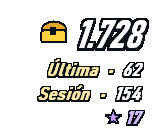
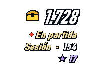
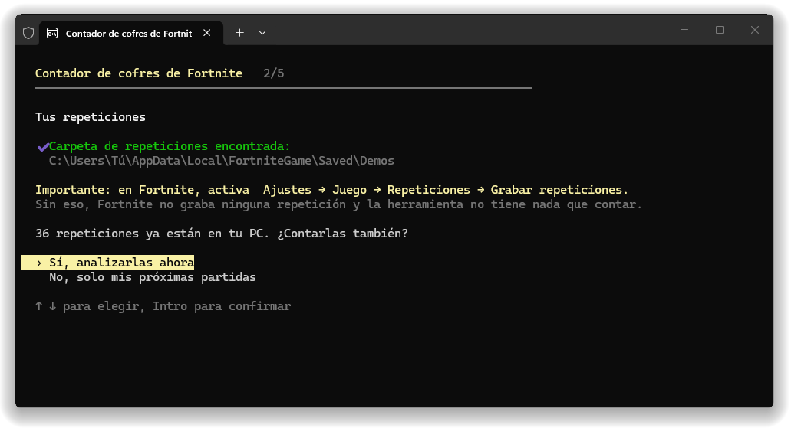
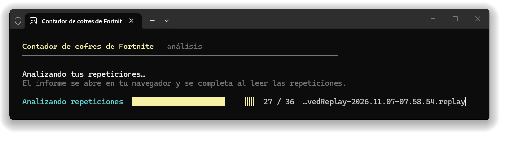
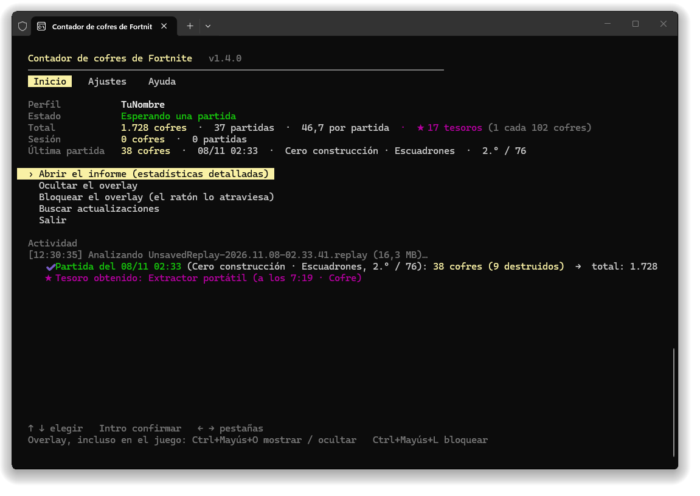
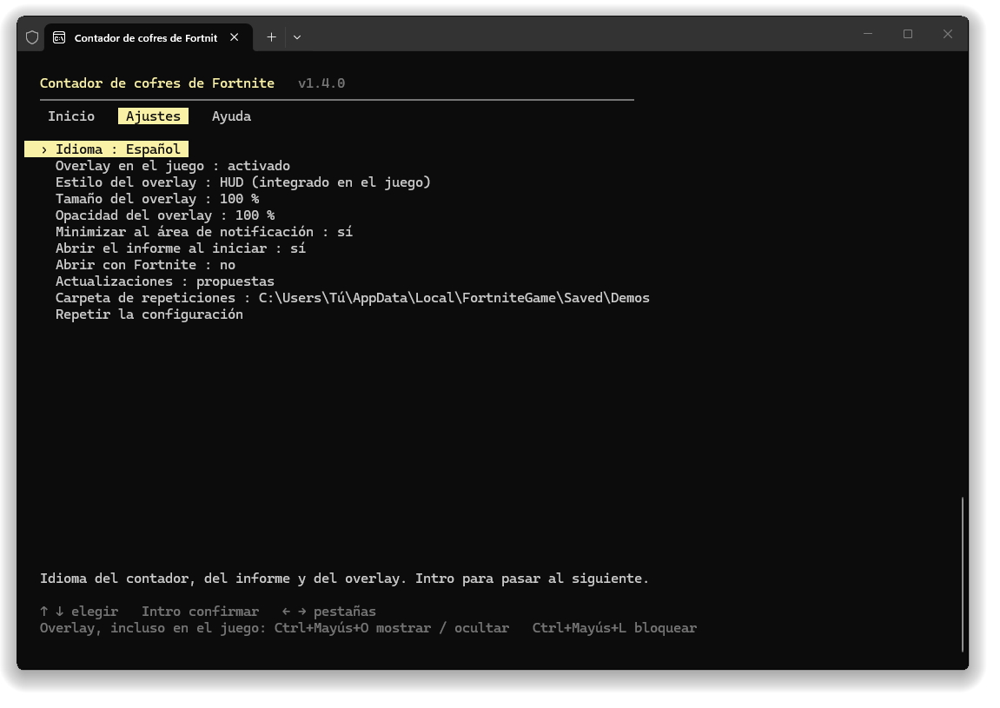
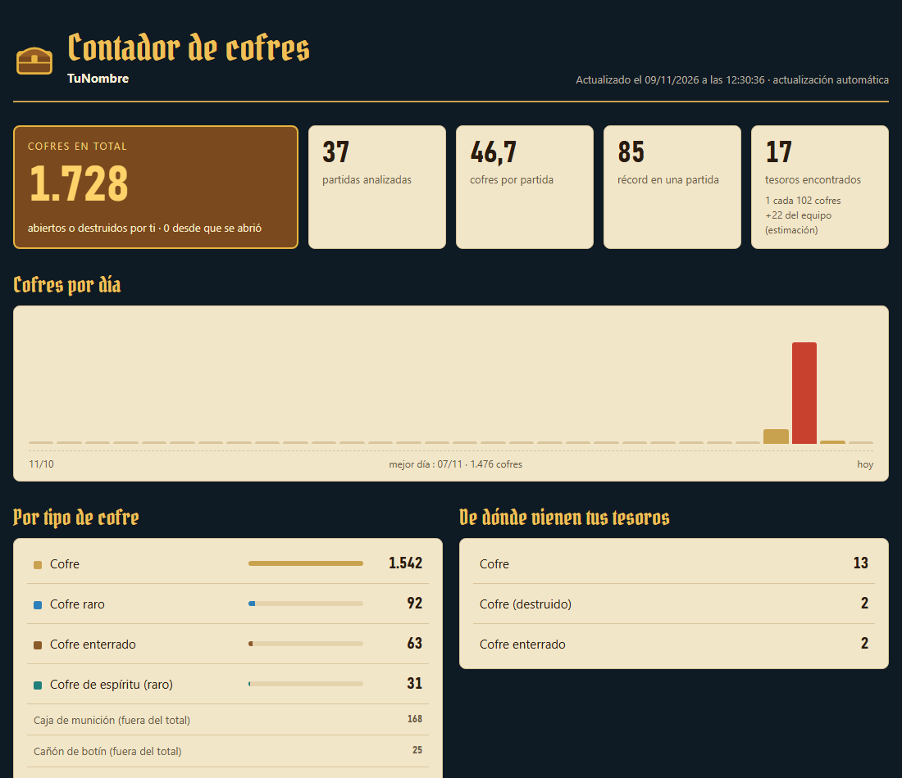

<div align="center">

[English](README.md) · [Français](README.fr.md) · **Español**


# Contador de cofres de Fortnite

[](../../releases/latest) [](../../releases)  [](LICENSE)

**Cuenta cada cofre que abres en Fortnite, partida tras partida, con un overlay integrado en el juego.**

&nbsp;&nbsp;&nbsp;&nbsp;

[**⬇ Descargar ChestCounter.exe**](../../releases/latest) · Windows 10 / 11 · gratis · sin instalación

</div>

---

Chest Counter lee las repeticiones que Fortnite guarda después de cada partida y lleva la cuenta de los cofres que has abierto, además de los **tesoros de la búsqueda del tesoro** conseguidos con tus cofres. Un overlay transparente muestra tus cifras encima del juego, como el resto del HUD, y un informe detallado guarda todo tu historial.

> Cuenta los cofres **que has abierto**. No muestra dónde están los cofres en el mapa.

## Cómo funciona (y por qué es seguro)

Fortnite puede grabar un **archivo de repetición** de cada partida en tu PC. Chest Counter lee esos archivos cuando termina la partida, y nada más.

- ✅ **Solo lee archivos de repetición**: los archivos `.replay` que Fortnite escribe en `%LOCALAPPDATA%\FortniteGame\Saved\Demos`. Se abren en solo lectura y nunca se modifican.
- ✅ **Ninguna modificación del juego**: no se toca nada en la carpeta de instalación de Fortnite, no se añade ni se cambia ningún archivo.
- ✅ **Ningún acceso a la memoria del juego**: la herramienta nunca lee, escribe ni inyecta nada en el proceso de Fortnite. No interactúa en absoluto con el juego en curso.
- ✅ **No se envía ningún dato**: sin inicio de sesión, sin acceso a tu cuenta de Epic, sin telemetría. Su único acceso a la red es la comprobación de una nueva versión en GitHub, que se puede desactivar en los ajustes.
- ✅ **Ligero**: funciona con prioridad baja (y en «modo de eficiencia» en Windows 11), duerme entre partidas, y el overlay solo se redibuja cuando cambia una cifra.

> [!IMPORTANT]
> **Las repeticiones deben estar activadas en Fortnite**: *Ajustes → Juego → Repeticiones → Grabar repeticiones: **Activado***. Sin repeticiones, la herramienta no tiene nada que leer.

Como Fortnite solo escribe la clave de descifrado de la repetición al final de la partida, los cofres se cuentan **unos segundos después de cada partida**, no durante ella. Mientras juegas, el overlay muestra **● En partida**.

## Para empezar

1. Descarga **[`ChestCounter.exe`](../../releases/latest)**. Con este único archivo basta.
2. Activa las repeticiones en Fortnite (ver arriba).
3. Ejecuta `ChestCounter.exe`.
   > Windows puede mostrar *«Windows protegió tu PC»* porque el exe no está firmado. Haz clic en *Más información → Ejecutar de todas formas*.
4. Una breve configuración (flechas + Intro) te pide tu **idioma** (francés / inglés / español), comprueba tu **carpeta de repeticiones**, te propone contar las **repeticiones que ya están en tu PC** y luego te pregunta si quieres el **overlay en el juego** y si el contador debe **abrirse automáticamente con Fortnite**.

<p align="center"></p>

Si cuentas tus repeticiones existentes, una barra de progreso avanza mientras el informe se abre en tu navegador y se completa en directo:

<p align="center"></p>

5. Deja el contador abierto mientras juegas. Al minimizarlo se coloca en el **área de notificación**, junto al reloj (icono del cofre): un clic en él lo vuelve a abrir. Unos segundos después de cada partida, se añaden sus cofres:

<p align="center"></p>

> [!TIP]
> Fortnite solo conserva un número limitado de repeticiones no guardadas y borra las más antiguas, y una partida jugada con el contador cerrado no se cuenta. Activa **Abrir con Fortnite** (se propone en la configuración, o en la pestaña **Ajustes**) para olvidarte de ello.

## Usar el contador

Todo funciona con las **flechas** e **Intro**, sin teclas que recordar. **← →** cambian de pestaña:

- **Inicio**: tu perfil, lo que hace el contador (esperando, partida en curso…), tu total, tu sesión y tu última partida. El menú abre el informe, muestra o bloquea el overlay, cambia de perfil e instala las actualizaciones. Abajo, la actividad muestra cada partida contada.
- **Ajustes**: cada ajuste se cambia con Intro, y una frase lo explica abajo.
- **Ayuda**: cómo funciona, los atajos del overlay, tu carpeta de datos y un enlace para informar de un problema.

<p align="center"></p>

| Ajuste | Qué hace |
|---|---|
| Idioma | Francés, inglés o español. |
| Overlay en el juego | Activado o desactivado (ni ventana ni atajos: todo queda en el informe). |
| Estilo, tamaño y opacidad del overlay | HUD o clásico, del 70 al 175 %, del 100 al 30 % de opacidad. Se aplican al instante. |
| Minimizar al área de notificación | Sí: al minimizar el contador se coloca junto al reloj en lugar de la barra de tareas. |
| Abrir el informe al iniciar | Abre el informe cada vez que se inicia el contador. |
| Abrir con Fortnite | Ver abajo. |
| Actualizaciones | Propuestas, instaladas automáticamente o desactivadas. |
| Carpeta de repeticiones | Cámbiala solo si la moviste. |
| Repetir la configuración | Borra tus ajustes y vuelve a hacer la configuración. Tu historial se conserva. |

## Abrir con Fortnite

Con esta opción, un pequeño proceso invisible se inicia con Windows y comprueba cada pocos segundos si Fortnite está abierto. No lee nada del juego: solo mira la lista de programas abiertos. Cuando Fortnite se inicia, abre el contador directamente en el área de notificación (el juego conserva la pantalla). Cuando Fortnite se cierra, el contador cuenta tu última partida y se cierra 30 segundos después; pulsa una tecla en su ventana para mantenerlo abierto. Se puede desactivar en cualquier momento en la pestaña **Ajustes**: el proceso invisible se detiene y se quita del inicio de Windows. Mientras la opción está activada, el proceso invisible sigue funcionando después de salir del contador, así que Windows no deja borrar ni mover `ChestCounter.exe`. Desactiva antes la opción.

## El overlay

Solo las cifras, con contorno como las del juego, sin fondo: colócalo bajo el minimapa y se integra en el HUD.

- **En grande**: tu **total** de cofres, con el cofre dorado.
- **Última**: los cofres de tu última partida. Durante una partida: **● En partida** (sus cofres se cuentan al final).
- **Sesión**: los cofres desde que se abrió el contador.
- **★**: tus tesoros.

| Atajo | Qué hace |
|---|---|
| **Ctrl+Mayús+O** | Mostrar / ocultar el overlay. Funciona en cualquier sitio, incluso en el juego. |
| **Ctrl+Mayús+L** | Bloquear / desbloquear. **Bloqueado**: el ratón lo atraviesa (ideal en el juego). **Desbloqueado**: aparece un fondo, arrástralo con el clic izquierdo, clic derecho para ocultarlo. |

Para verlo encima del juego, pon Fortnite en **«Pantalla completa en ventana»** (*Ajustes → Vídeo → Modo ventana*): en pantalla completa exclusiva, Windows no puede mostrar nada encima del juego. ¿Prefieres el overlay anterior, una tarjeta oscura con más detalles? *Ajustes → Estilo del overlay → clásico*. ¿No lo quieres? *Ajustes → Overlay en el juego → desactivado*. ¿Haces streaming? `overlay.html` es un overlay con fondo transparente para una fuente de navegador de **OBS**.

## El informe

`report.html` se abre en tu navegador y se actualiza solo: total, media, récord, cofres por día, tipos de cofre, tesoros (y **1 tesoro cada N cofres**) y cada partida. Sigue el tema de Windows: versión de noche o de día.

<p align="center"></p>

## Tesoros

- **★★ Cofre dorado (seguro).** Cuando un cofre da una recompensa de la búsqueda del tesoro (cosmético, pista musical, pantalla de carga, vehículo…), el servidor hace aparecer un cofre dorado que lleva el **identificador del premio**. La herramienta lo lee en la repetición.
- **★ Cada tesoro recibido (momento exacto).** Cada tesoro que recibes se registra con su momento exacto y el cofre del que salió; solo cuenta si ese cofre es **tuyo**. Cuando el objeto se puede identificar, se muestra su nombre; si no, aparece como **«Artilugio de tesoro»** (fuego artificial dorado, extractor portátil, localizadores, acelerador de extracción), cuyo tipo exacto no está en la repetición.
- **Tesoros del equipo (estimación).** La búsqueda del tesoro comparte cada tesoro con todo el equipo: los que encuentran tus compañeros pueden mostrarse en el informe (casilla), marcados con el icono de equipo. Se deducen de los tesoros que recibes sin abrir un cofre, y nunca cuentan en tus totales.
- Un tesoro que viene de algo que no es un cofre (caja de munición…) se marca con ⚑ y **fiabilidad baja**: muy probablemente es un error al leer la repetición.

El juego solo envía identificadores, no nombres: los nombres de los premios conocidos vienen integrados en la herramienta.

## Perfiles (varias cuentas en un PC)

Las repeticiones guardadas en un PC suelen ser de su jugador: **no hay que escribir ningún nombre**, la herramienta cuenta al jugador que grabó cada repetición. Si encuentra repeticiones de varias cuentas, cada cuenta tiene su perfil con sus propias estadísticas. La herramienta pregunta entonces en cada inicio con qué cuenta juegas, y puedes cambiar en cualquier momento con **Cambiar de perfil** en el inicio. Una partida jugada con otra cuenta se guarda en el perfil de esa cuenta, nunca se pierde.

## Actualizaciones

Al iniciarse, el contador comprueba en GitHub si hay una nueva versión. Si la hay, el inicio muestra **sus novedades en tu idioma**, con **Instalar la versión…**: se descarga, se comprueba y el contador se reinicia. Tu historial y tus ajustes se conservan. Después de la actualización, el inicio recuerda una vez lo que ha cambiado. **Buscar actualizaciones** vuelve a comprobar en GitHub en cualquier momento. En los ajustes puedes elegir *propuestas* (por defecto), *instaladas automáticamente* (solo entre dos partidas) o *desactivadas* (ningún acceso a la red).

## Tus datos

Todo se guarda en `%APPDATA%\ChestCounter` (**Ayuda → Abrir la carpeta de datos**):

| Archivo | Contenido |
|---|---|
| `report.html` | El informe (se abre en tu navegador). |
| `overlay.html` | Overlay transparente para OBS. |
| `matches.csv` | Una línea por partida, para Excel o Google Sheets. |
| `data.json` | Todo tu historial. **Guarda una copia** si cambias de PC. |
| `config.json` | Tus ajustes, tu perfil, la posición del overlay. |
| `errors.log` | El detalle de las repeticiones ilegibles, para adjuntar a un informe de error. |

Para empezar de cero: **Ajustes → Repetir la configuración** (tu historial se conserva), o borra esta carpeta. Si usabas la versión anterior (ChestTracker), tu carpeta `%APPDATA%\ChestTracker` se recupera automáticamente.

## Preguntas frecuentes

**No se cuenta nada.** Comprueba que las repeticiones están activadas en Fortnite y que el contador está abierto cuando termina la partida. El inicio te avisa si la carpeta de repeticiones no existe o está vacía.

**¿Se cuentan las cajas de munición?** No. Las cajas de munición, las cajas de comida y los cañones de botín se muestran aparte en el informe y no forman parte del total de cofres. Los cofres que **destruyes** en lugar de abrirlos sí se cuentan. Un cofre que se rellena durante la partida y que vuelves a abrir cuenta una vez más; volver a pasar cerca de un cofre ya abierto (cofre enterrado desenterrado, cofre de espíritu) no lo cuenta dos veces.

**¿Y los modos creativos?** Solo se cuentan las partidas de Battle Royale; los demás modos se ignoran.

**Fortnite se cerró en mitad de una partida.** Su repetición está incompleta (Fortnite nunca escribió la clave de descifrado): esa partida no se puede contar, y la herramienta la indica como «repetición incompleta».

**«No se puede leer esta repetición».** Una actualización de Fortnite puede cambiar el formato de las repeticiones; entonces hay que actualizar el lector. Las partidas ya contadas se conservan. [Abre una incidencia](../../issues) adjuntando `errors.log` (**Ayuda → Abrir el registro de errores**).

**No puedo borrar `ChestCounter.exe` («el archivo está abierto en otro programa»).** El proceso invisible de «Abrir con Fortnite» todavía lo usa, aunque el contador esté cerrado. Abre el contador y pon **Ajustes → Abrir con Fortnite** en *no*: el proceso se detiene y el exe se puede borrar.

**¿Dónde está la ventana?** Minimizada, está en el área de notificación (icono del cofre, a veces detrás de la pequeña flecha ^ junto al reloj). ¿Prefieres la barra de tareas? **Ajustes → Minimizar al área de notificación: no**.

**¿Ya está abierto?** Solo puede funcionar un contador a la vez: al abrirlo otra vez simplemente te indica que ya está abierto.

**¿Se puede contar una partida dos veces?** No, aunque cambies el nombre de la repetición o la guardes.

## Opciones de línea de comandos

```
ChestCounter.exe --lang <fr|en|es>   cambia el idioma
ChestCounter.exe --demos <carpeta>   otra carpeta de repeticiones
ChestCounter.exe --data <carpeta>    otra carpeta de datos
ChestCounter.exe --once              analiza las repeticiones terminadas y sale
ChestCounter.exe --reset-config      vuelve a hacer la configuración
ChestCounter.exe --overlay-preview <archivo.png>   guarda vistas previas del overlay y sale
```

## Compilarlo tú mismo

Instala el [SDK de .NET 10](https://dotnet.microsoft.com/download/dotnet/10.0) (Windows x64) y haz doble clic en **`build.bat`**: el exe se escribe en `dist\ChestCounter.exe`. El flujo de GitHub Actions compila el exe en cada push y lo adjunta a una release cuando se sube un tag `v*`, con el texto de [`RELEASE_NOTES.md`](RELEASE_NOTES.md) (que también se muestra en el contador después de una actualización).

## Licencia y créditos

[MIT](LICENSE). La lectura de las repeticiones se basa en [FortniteReplayDecompressor](https://github.com/Shiqan/FortniteReplayDecompressor) de Shiqan (MIT), ligeramente modificado: ver [`lib/PATCHES.md`](lib/PATCHES.md). Los títulos del informe usan la fuente [Pirata One](https://fonts.google.com/specimen/Pirata+One) (SIL Open Font License, [`src/ChestCounter/Assets/PirataOne-OFL.txt`](src/ChestCounter/Assets/PirataOne-OFL.txt)). Gracias a [koiseka](https://github.com/koiseka) por sus correcciones del recuento ([#6](../../pull/6)).

Este proyecto no está afiliado, aprobado ni patrocinado por Epic Games. Fortnite es una marca de Epic Games, Inc.
