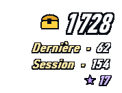
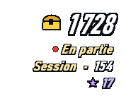
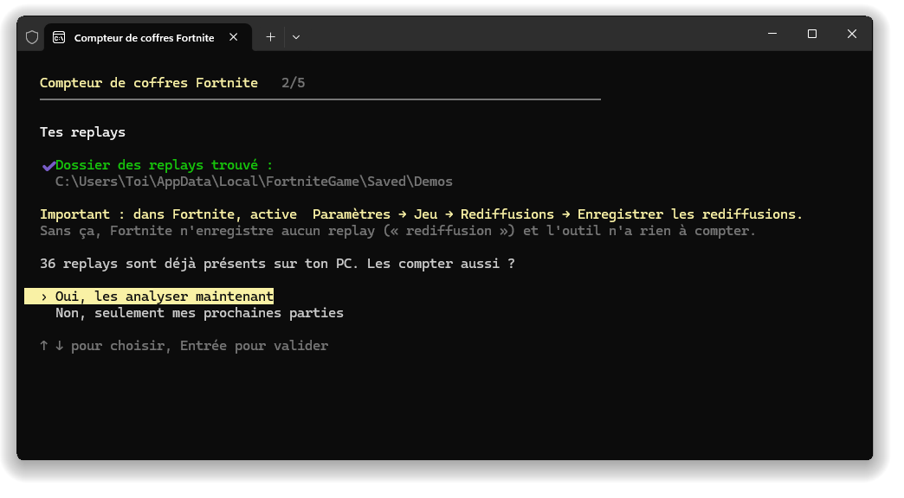
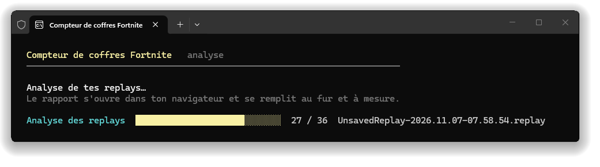
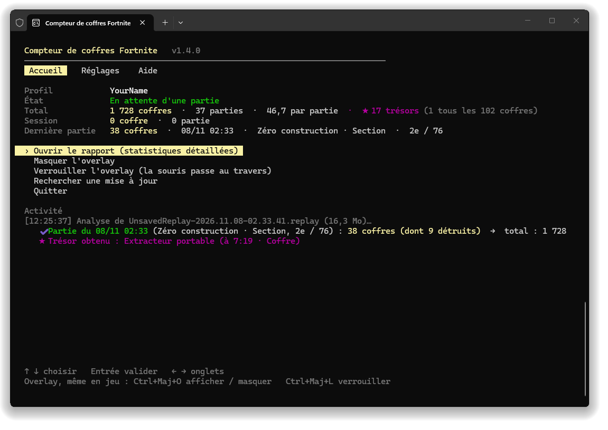
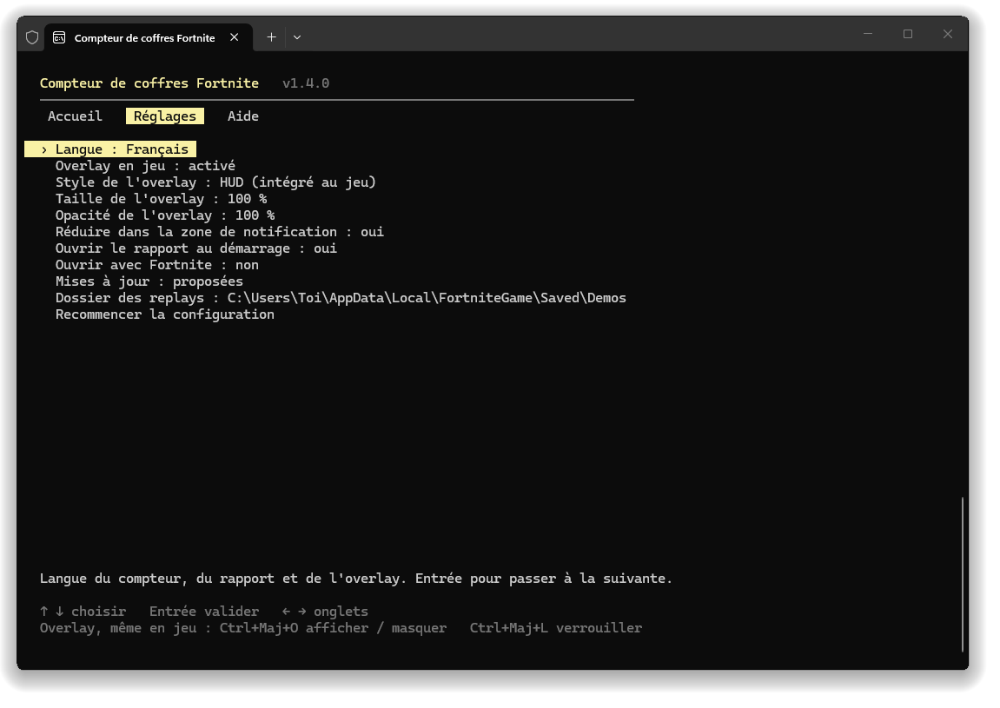
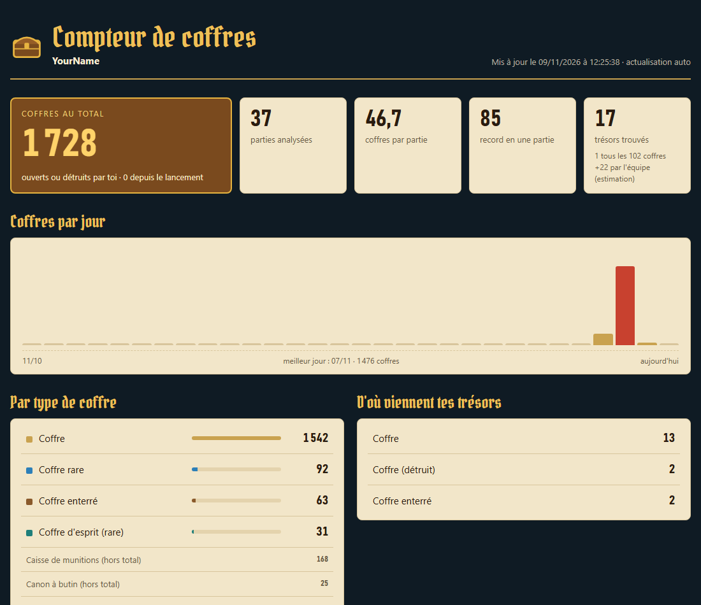

<div align="center">

[English](README.md) · **Français** · [Español](README.es.md)


# Compteur de coffres Fortnite

[](../../releases/latest) [](../../releases)  [](LICENSE)

**Compte chaque coffre que tu ouvres dans Fortnite, partie après partie, avec un overlay intégré au jeu.**

&nbsp;&nbsp;&nbsp;&nbsp;

[**⬇ Télécharger ChestCounter.exe**](../../releases/latest) · Windows 10 / 11 · gratuit · sans installation

</div>

---

Chest Counter lit les replays que Fortnite enregistre après chaque partie et tient le compte des coffres que tu as ouverts, ainsi que des **trésors de la chasse au trésor** obtenus grâce à tes coffres. Un overlay transparent affiche tes chiffres par-dessus le jeu, comme le reste du HUD, et un rapport détaillé garde tout ton historique.

> Il compte les coffres **que tu as ouverts**. Il ne montre pas où se trouvent les coffres sur la carte.

## Comment ça marche (et pourquoi c'est sans risque)

Fortnite peut enregistrer un **fichier replay** de chaque partie sur ton PC. Chest Counter lit ces fichiers une fois la partie terminée, et rien d'autre.

- ✅ **Lit uniquement les replays** : les fichiers `.replay` que Fortnite écrit dans `%LOCALAPPDATA%\FortniteGame\Saved\Demos`. Ils sont ouverts en lecture seule et jamais modifiés.
- ✅ **Aucune modification du jeu** : rien n'est touché dans le dossier d'installation de Fortnite, aucun fichier n'est ajouté ni modifié.
- ✅ **Aucun accès à la mémoire du jeu** : l'outil ne lit, n'écrit et n'injecte jamais rien dans le processus de Fortnite. Il n'interagit pas du tout avec le jeu en cours.
- ✅ **Aucune donnée envoyée** : pas de connexion, pas d'accès à ton compte Epic, pas de télémétrie. Le seul accès réseau est la vérification d'une nouvelle version sur GitHub, désactivable dans les réglages.
- ✅ **Léger** : tourne en priorité basse (et en « mode efficacité » sous Windows 11), dort entre les parties, et l'overlay n'est redessiné que quand un chiffre change.

> [!IMPORTANT]
> **Les replays (« rediffusions » dans Fortnite) doivent être activés** : *Paramètres → Jeu → Rediffusions → Enregistrer les rediffusions : **Activé***. Sans replays, l'outil n'a rien à lire.

Comme Fortnite n'écrit la clé de déchiffrement du replay qu'à la fin de la partie, les coffres sont comptés **quelques secondes après chaque partie**, pas pendant. Pendant que tu joues, l'overlay affiche **● En partie**.

## Pour commencer

1. Télécharge **[`ChestCounter.exe`](../../releases/latest)**. Ce seul fichier suffit.
2. Active les replays dans Fortnite (voir ci-dessus).
3. Lance `ChestCounter.exe`.
   > Windows peut afficher *« Windows a protégé votre ordinateur »*, car l'exe n'est pas signé. Clique sur *Informations complémentaires → Exécuter quand même*.
4. Une courte installation (flèches + Entrée) te demande ta **langue** (français / anglais / espagnol), vérifie ton **dossier de replays**, propose de compter les **replays déjà présents** sur ton PC, puis demande si tu veux **l'overlay en jeu** et si le compteur doit **s'ouvrir automatiquement avec Fortnite**.

<p align="center"></p>

Si tu comptes tes replays existants, une barre de progression avance pendant que le rapport s'ouvre dans ton navigateur et se remplit en direct :

<p align="center"></p>

5. Laisse le compteur ouvert pendant que tu joues. Le réduire le range dans la **zone de notification**, à côté de l'horloge (icône du coffre) : un clic dessus le rouvre. Quelques secondes après chaque partie, ses coffres sont ajoutés :

<p align="center"></p>

> [!TIP]
> Fortnite ne garde qu'un nombre limité de replays non sauvegardés et efface les plus anciens, et une partie jouée pendant que le compteur est fermé n'est pas comptée. Active **Ouvrir avec Fortnite** (proposé à l'installation, ou dans l'onglet **Réglages**) pour ne plus y penser.

## Utiliser le compteur

Tout se fait avec les **flèches** et **Entrée**, sans touche à retenir. **← →** passent d'un onglet à l'autre :

- **Accueil** : ton profil, l'état du compteur (en attente, partie en cours…), ton total, ta session et ta dernière partie. Le menu ouvre le rapport, affiche ou verrouille l'overlay, change de profil et installe les mises à jour. En bas, l'activité montre chaque partie comptée.
- **Réglages** : chaque réglage se change avec Entrée, et une phrase l'explique en bas de l'écran.
- **Aide** : comment ça marche, les raccourcis de l'overlay, ton dossier de données, et un lien pour signaler un problème.

<p align="center"></p>

| Réglage | Ce qu'il fait |
|---|---|
| Langue | Français, anglais ou espagnol. |
| Overlay en jeu | Activé ou désactivé (aucune fenêtre ni raccourci : tout reste dans le rapport). |
| Style, taille, opacité de l'overlay | HUD ou classique, de 70 à 175 %, de 100 à 30 % d'opacité. Appliqués tout de suite. |
| Réduire dans la zone de notification | Oui : réduire le compteur le range à côté de l'horloge au lieu de la barre des tâches. |
| Ouvrir le rapport au démarrage | Ouvre le rapport à chaque lancement. |
| Ouvrir avec Fortnite | Voir ci-dessous. |
| Mises à jour | Proposées, installées automatiquement ou désactivées. |
| Dossier des replays | À changer seulement si tu l'as déplacé. |
| Recommencer la configuration | Efface tes réglages et relance l'installation. Ton historique est conservé. |

## Ouvrir avec Fortnite

Avec cette option, un tout petit processus invisible démarre avec Windows et vérifie toutes les quelques secondes si Fortnite est lancé. Il ne lit rien du jeu : il regarde seulement la liste des programmes ouverts. Quand Fortnite démarre, il ouvre le compteur directement dans la zone de notification (le jeu garde l'écran). Quand Fortnite se ferme, le compteur compte ta dernière partie puis se ferme 30 secondes plus tard ; appuie sur une touche dans sa fenêtre pour le garder ouvert. Désactivable à tout moment dans l'onglet **Réglages** : le processus invisible s'arrête et est retiré du démarrage de Windows. Tant que l'option est active, le processus invisible continue de tourner après avoir quitté le compteur : Windows refuse donc de supprimer ou déplacer `ChestCounter.exe`. Désactive d'abord l'option.

## L'overlay

Seulement des chiffres, cernés comme ceux du jeu, sans fond : place-le sous la minimap et il se fond dans le HUD.

- **En grand** : ton **total** de coffres, avec le coffre doré.
- **Dernière** : les coffres de ta dernière partie. Pendant une partie : **● En partie** (ses coffres sont comptés à la fin).
- **Session** : les coffres depuis le lancement du compteur.
- **★** : tes trésors.

| Raccourci | Ce qu'il fait |
|---|---|
| **Ctrl+Maj+O** | Afficher / masquer l'overlay. Fonctionne partout, même en jeu. |
| **Ctrl+Maj+L** | Verrouiller / déverrouiller. **Verrouillé** : la souris passe au travers (idéal en jeu). **Déverrouillé** : un fond apparaît, clic gauche maintenu pour le déplacer, clic droit pour le masquer. |

Pour le voir par-dessus le jeu, mets Fortnite en **« Plein écran fenêtré »** (*Paramètres → Vidéo → Mode de fenêtre*) : en plein écran exclusif, Windows ne peut rien afficher par-dessus le jeu. Tu préfères l'ancien overlay, une carte sombre avec plus de détails ? *Réglages → Style de l'overlay → classique*. Tu n'en veux pas du tout ? *Réglages → Overlay en jeu → désactivé*. Tu streames ? `overlay.html` est un overlay à fond transparent pour une source navigateur **OBS**.

## Le rapport

`report.html` s'ouvre dans ton navigateur et se met à jour tout seul : total, moyenne, record, coffres par jour, détail par type de coffre, trésors (et **1 trésor tous les N coffres**) et chaque partie. Il suit le thème de Windows : version nuit ou jour.

<p align="center"></p>

## Trésors

- **★★ Coffre doré (certain).** Quand un coffre rapporte une récompense de la chasse au trésor (cosmétique, piste musicale, écran de chargement, véhicule…), le serveur fait apparaître un coffre doré qui porte l'**identifiant de la récompense**. L'outil le lit dans le replay.
- **★ Chaque trésor reçu (moment exact).** Chaque trésor reçu est enregistré avec son moment exact et le coffre d'où il vient ; il n'est compté que si ce coffre est **le tien**. Quand l'objet est identifiable, il est nommé ; sinon il s'affiche **« Gizmo de trésor »** (feu d'artifice doré, extracteur portable, localisateurs, accélérateur d'extraction), dont le type exact n'est pas dans le replay.
- **Trésors de l'équipe (estimation).** La chasse au trésor partage chaque trésor avec toute l'équipe : ceux trouvés par tes coéquipiers peuvent s'afficher dans le rapport (case à cocher), marqués de l'icône équipe. Ils sont déduits des trésors que tu reçois sans avoir ouvert de coffre, et n'entrent jamais dans tes totaux.
- Un trésor venu d'autre chose qu'un coffre (caisse de munitions…) est signalé par ⚑ avec une **fiabilité faible** : c'est très probablement une erreur d'analyse du replay.

Le jeu ne transmet que des identifiants, pas les noms : les noms des récompenses connues sont intégrés à l'outil.

## Profils (plusieurs comptes sur un PC)

Les replays enregistrés sur un PC sont normalement ceux de son joueur : **pas de pseudo à taper**, l'outil compte le joueur qui a enregistré chaque replay. S'il trouve des replays de plusieurs comptes, chaque compte a son profil avec ses propres statistiques. L'outil demande alors à chaque lancement sur quel compte tu joues, et tu peux changer à tout moment avec **Changer de profil** dans l'accueil. Une partie jouée sur un autre compte est enregistrée dans le profil de ce compte, jamais perdue.

## Mises à jour

Au démarrage, le compteur vérifie s'il existe une nouvelle version sur GitHub. Si c'est le cas, l'accueil affiche **ses nouveautés dans ta langue**, avec **Installer la version…** : elle est téléchargée, vérifiée, et le compteur redémarre. Ton historique et tes réglages sont conservés. Après la mise à jour, l'accueil rappelle une fois ce qui a changé. **Rechercher une mise à jour** revérifie sur GitHub à tout moment. Dans les réglages, tu peux choisir *proposées* (par défaut), *installées automatiquement* (seulement entre deux parties) ou *désactivées* (aucun accès réseau).

## Tes données

Tout est rangé dans `%APPDATA%\ChestCounter` (onglet **Aide → Ouvrir le dossier des données**) :

| Fichier | Contenu |
|---|---|
| `report.html` | Le rapport (s'ouvre dans ton navigateur). |
| `overlay.html` | Overlay transparent pour OBS. |
| `matches.csv` | Une ligne par partie, pour Excel ou Google Sheets. |
| `data.json` | Tout ton historique. **Sauvegarde-le** si tu changes de PC. |
| `config.json` | Tes réglages, ton profil, la position de l'overlay. |
| `errors.log` | Le détail des replays illisibles, à joindre à un rapport de bug. |

Pour tout recommencer : **Réglages → Recommencer la configuration** (ton historique est conservé), ou supprime ce dossier. Si tu utilisais l'ancienne version (ChestTracker), ton dossier `%APPDATA%\ChestTracker` est repris automatiquement.

## FAQ

**Rien n'est compté.** Vérifie que les rediffusions sont activées dans Fortnite, et que le compteur tourne quand la partie se termine. L'accueil te prévient si le dossier des replays est absent ou vide.

**Les caisses de munitions sont-elles comptées ?** Non. Caisses de munitions, de nourriture et canons à butin sont listés à part dans le rapport et n'entrent pas dans le total. Les coffres que tu **détruis** au lieu de les ouvrir sont comptés. Un coffre qui se remplit à nouveau pendant la partie et que tu rouvres compte une fois de plus ; repasser près d'un coffre déjà ouvert (coffre enterré creusé, coffre d'esprit) ne le compte pas deux fois.

**Et les modes créatifs ?** Seules les parties Battle Royale sont comptées ; les autres modes sont ignorés.

**Fortnite s'est fermé en pleine partie.** Son replay est incomplet (Fortnite n'a jamais écrit la clé de déchiffrement) : cette partie ne peut pas être comptée, et l'outil la signale comme « replay incomplet ».

**« Impossible de lire ce replay ».** Une mise à jour de Fortnite peut changer le format des replays ; le parseur doit alors être mis à jour. Les parties déjà comptées sont conservées. [Ouvre un ticket](../../issues) en joignant `errors.log` (onglet **Aide → Ouvrir le journal d'erreurs**).

**Impossible de supprimer `ChestCounter.exe` (« le fichier est ouvert dans un autre programme »).** Le processus invisible d'« Ouvrir avec Fortnite » l'utilise encore, même compteur fermé. Ouvre le compteur et mets **Réglages → Ouvrir avec Fortnite** sur *non* : le processus s'arrête et l'exe peut être supprimé.

**Où est passée la fenêtre ?** Réduite, elle est dans la zone de notification (icône du coffre, parfois derrière la petite flèche ^ à côté de l'horloge). Tu préfères la barre des tâches ? **Réglages → Réduire dans la zone de notification : non**.

**Déjà ouvert ?** Un seul compteur peut tourner à la fois : le relancer indique simplement qu'il est déjà ouvert.

**Une partie peut-elle être comptée deux fois ?** Non, même si tu renommes ou sauvegardes le replay.

## Options en ligne de commande

```
ChestCounter.exe --lang <fr|en|es>   change la langue
ChestCounter.exe --demos <dossier>   autre dossier de replays
ChestCounter.exe --data <dossier>    autre dossier de données
ChestCounter.exe --once              analyse les replays terminés puis quitte
ChestCounter.exe --reset-config      relance l'installation
ChestCounter.exe --overlay-preview <fichier.png>   enregistre des aperçus de l'overlay puis quitte
```

## Compiler soi-même

Installe le [SDK .NET 10](https://dotnet.microsoft.com/download/dotnet/10.0) (Windows x64), puis double-clique sur **`build.bat`** : l'exe est écrit dans `dist\ChestCounter.exe`. Le workflow GitHub Actions compile l'exe à chaque push et le joint à une release quand un tag `v*` est poussé, avec le texte de [`RELEASE_NOTES.md`](RELEASE_NOTES.md) (aussi affiché dans le compteur après une mise à jour).

## Licence et crédits

[MIT](LICENSE). La lecture des replays repose sur [FortniteReplayDecompressor](https://github.com/Shiqan/FortniteReplayDecompressor) de Shiqan (MIT), légèrement modifié : voir [`lib/PATCHES.md`](lib/PATCHES.md). Les titres du rapport utilisent la police [Pirata One](https://fonts.google.com/specimen/Pirata+One) (SIL Open Font License, [`src/ChestCounter/Assets/PirataOne-OFL.txt`](src/ChestCounter/Assets/PirataOne-OFL.txt)). Merci à [koiseka](https://github.com/koiseka) pour ses corrections du comptage ([#6](../../pull/6)).

Ce projet n'est ni affilié, ni approuvé, ni sponsorisé par Epic Games. Fortnite est une marque d'Epic Games, Inc.
