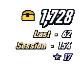
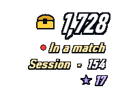
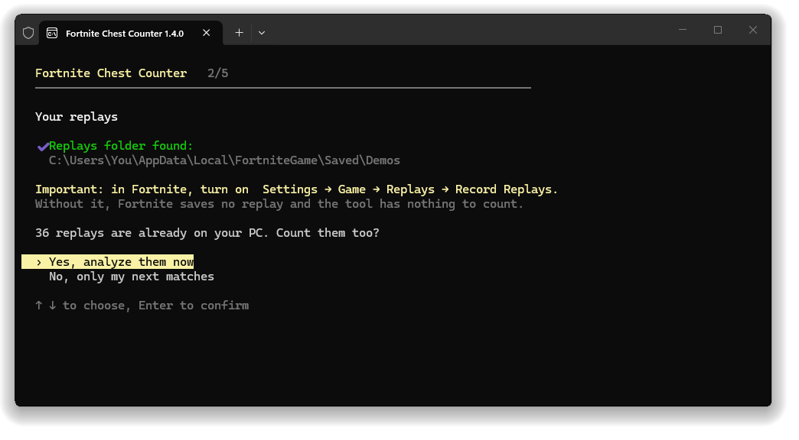
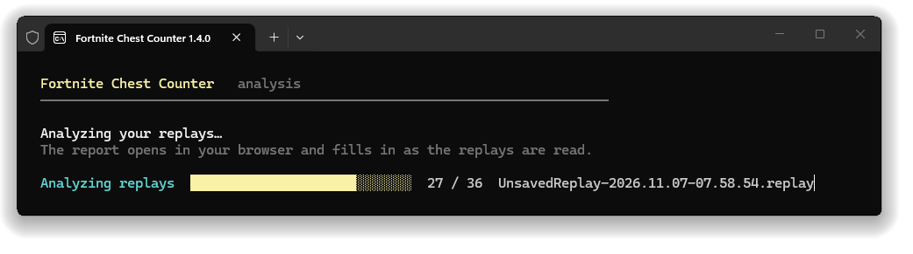
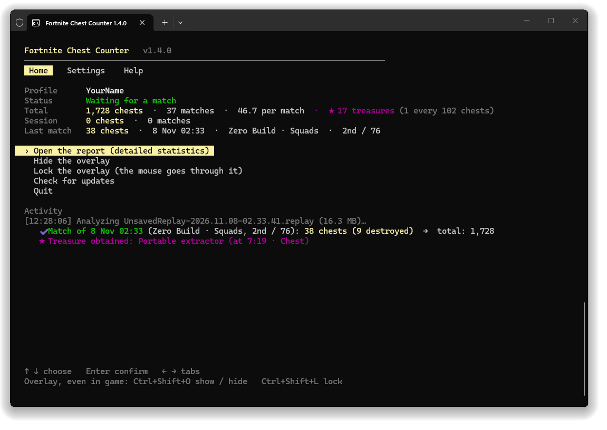
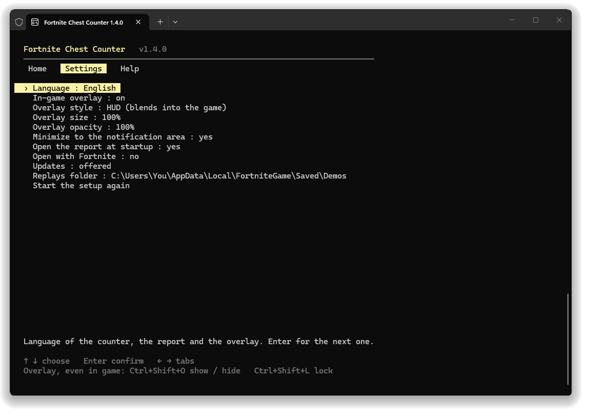
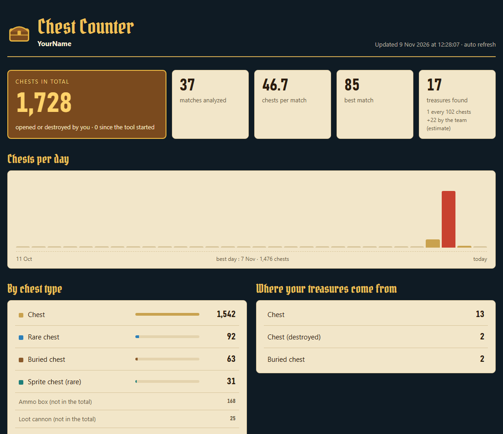

<div align="center">

**English** · [Français](README.fr.md) · [Español](README.es.md)


# Fortnite Chest Counter

[](../../releases/latest) [](../../releases)  [](LICENSE)

**Counts every chest you open in Fortnite, match after match, with an overlay that blends into the game.**

&nbsp;&nbsp;&nbsp;&nbsp;

[**⬇ Download ChestCounter.exe**](../../releases/latest) · Windows 10 / 11 · free · no install

</div>

---

Chest Counter reads the replays Fortnite saves after each match and keeps a running count of the chests you opened, along with the **treasure hunt treasures** you got from your chests. A transparent overlay shows your figures over the game, like the rest of the HUD, and a detailed report keeps your whole history.

> It counts the chests **you opened**. It does not show where chests are on the map.

## How it works (and why it is safe)

Fortnite can record a **replay file** of every match on your PC. Chest Counter reads these files once the match is over, and nothing else.

- ✅ **Only reads replay files**: the `.replay` files Fortnite writes to `%LOCALAPPDATA%\FortniteGame\Saved\Demos`. They are opened read-only and never modified.
- ✅ **No game modification**: nothing in the Fortnite install folder is touched, no file is added or changed.
- ✅ **No access to the game's memory**: the tool never reads, writes or injects anything into the Fortnite process. It does not interact with the running game at all.
- ✅ **No data sent**: no login, no access to your Epic account, no telemetry. Its only network access is the check for a new version on GitHub, which can be turned off in the settings.
- ✅ **Lightweight**: runs at low priority (and in "efficiency mode" on Windows 11), sleeps between matches, and the overlay is only redrawn when a number changes.

> [!IMPORTANT]
> **Replays must be turned on in Fortnite**: *Settings → Game → Replays → Record Replays: **On***. Without replays, the tool has nothing to read.

Because Fortnite only writes the replay's decryption key when the match ends, chests are counted **a few seconds after each match**, not during it. While you play, the overlay shows **● In a match**.

## Getting started

1. Download **[`ChestCounter.exe`](../../releases/latest)**. This single file is all you need.
2. Turn on replays in Fortnite (see above).
3. Run `ChestCounter.exe`.
   > Windows may show *"Windows protected your PC"* because the exe is not signed. Click *More info → Run anyway*.
4. A short setup (arrow keys + Enter) asks for your **language** (French / English / Spanish), checks your **replays folder**, offers to count the **replays already on your PC**, then asks whether you want the **in-game overlay** and whether the counter should **open automatically with Fortnite**.

<p align="center"></p>

If you count your existing replays, a progress bar moves while the report opens in your browser and fills in live:

<p align="center"></p>

5. Keep the counter open while you play. Minimizing it puts it in the **notification area**, next to the clock (chest icon): a click on it opens it again. A few seconds after each match, its chests are added:

<p align="center"></p>

> [!TIP]
> Fortnite only keeps a limited number of unsaved replays and deletes the oldest ones, and a match played while the counter is closed is not counted. Turn on **Open with Fortnite** (offered during setup, or in the **Settings** tab) so you never have to think about it.

## Using the counter

Everything works with the **arrow keys** and **Enter**, with no key to remember. **← →** switch tabs:

- **Home**: your profile, what the counter is doing (waiting, match in progress…), your total, your session and your last match. The menu opens the report, shows or locks the overlay, switches profile and installs updates. At the bottom, the activity shows each match counted.
- **Settings**: each setting changes with Enter, and a line at the bottom explains it.
- **Help**: how it works, the overlay shortcuts, your data folder, and a link to report a problem.

<p align="center"></p>

| Setting | What it does |
|---|---|
| Language | French, English or Spanish. |
| In-game overlay | On or off (no window and no shortcut: everything stays in the report). |
| Overlay style, size, opacity | HUD or classic, 70 to 175%, 100 to 30% opacity. Applied at once. |
| Minimize to the notification area | Yes: minimizing the counter puts it next to the clock instead of the taskbar. |
| Open the report at startup | Opens the report each time the counter starts. |
| Open with Fortnite | See below. |
| Updates | Offered, installed automatically or off. |
| Replays folder | Only change it if you moved it. |
| Start the setup again | Clears your settings and runs the setup again. Your history is kept. |

## Open with Fortnite

With this option, a tiny invisible process starts with Windows and checks every few seconds whether Fortnite is running. It reads nothing from the game: it only looks at the list of running programs. When Fortnite starts, it opens the counter straight into the notification area (the game keeps the screen). When Fortnite closes, the counter counts your last match, then closes 30 seconds later; press any key in its window to keep it open. Can be turned off at any time in the **Settings** tab: the invisible process stops and is removed from the Windows startup. While the option is on, the invisible process keeps running after you quit the counter, so Windows refuses to delete or move `ChestCounter.exe`. Turn the option off first.

## The overlay

Just the figures, outlined like the game's own, with no background: put it under the minimap and it blends into the HUD.

- **Big**: your **total** chests, with the golden chest.
- **Last**: the chests of your last match. During a match: **● In a match** (its chests are counted at the end).
- **Session**: the chests since the counter was started.
- **★**: your treasures.

| Shortcut | What it does |
|---|---|
| **Ctrl+Shift+O** | Show / hide the overlay. Works anywhere, even in game. |
| **Ctrl+Shift+L** | Lock / unlock. **Locked**: the mouse goes through it (best in game). **Unlocked**: a background shows, hold the left mouse button to move it, right-click to hide it. |

To see it over the game, set Fortnite to **Windowed Fullscreen** (*Settings → Video → Window Mode*): in exclusive fullscreen, Windows cannot draw anything on top of the game. Prefer the old overlay, a dark card with more details? *Settings → Overlay style → classic*. Don't want one at all? *Settings → In-game overlay → off*. Streaming? `overlay.html` is an overlay with a transparent background for an **OBS** browser source.

## The report

`report.html` opens in your browser and updates by itself: total, average, best match, chests per day, chest types, treasures (and **1 treasure every N chests**) and every match. It follows the Windows theme: night or day version.

<p align="center"></p>

## Treasures

- **★★ Golden chest (certain).** When a chest gives a treasure hunt reward (cosmetic, jam track, loading screen, vehicle…), the server spawns a golden chest carrying the **prize id**. The tool reads it from the replay.
- **★ Every treasure received (exact moment).** Each treasure you receive is recorded with its exact time and the chest it came from; it only counts if that chest is **yours**. When the item can be identified it is named; otherwise it shows as **"Treasure gizmo"** (golden firework, portable extractor, locators, extraction accelerator), whose exact type is not in the replay.
- **Team treasures (estimate).** The treasure hunt shares every treasure with the whole team: the ones your teammates find can be shown in the report (checkbox), marked with the team icon. They are deduced from the treasures you receive without opening a chest, and never count in your totals.
- A treasure that came from something other than a chest (ammo box…) is flagged with ⚑ and **low reliability**: it is most likely a mistake in reading the replay.

The game only sends prize ids, not names: the names of the known prizes are built into the tool.

## Profiles (several accounts on one PC)

The replays saved on a PC are normally its player's: **no name to type**, the tool counts the player who recorded each replay. If it finds replays from several accounts, each account gets its own profile with its own statistics. The tool then asks at each launch which account you play on, and you can switch at any time with **Switch profile** on the home tab. A match played on another account is saved in that account's profile, never lost.

## Updates

At startup, the counter checks GitHub for a new version. If there is one, the home tab shows **what's new in your language**, with **Install version…**: it is downloaded, verified, and the counter restarts. Your history and settings are kept. After the update, the home tab shows once what has changed. **Check for updates** asks GitHub again at any time. In the settings you can choose *offered* (default), *installed automatically* (only between two matches) or *off* (no network access at all).

## Your data

Everything is stored in `%APPDATA%\ChestCounter` (**Help → Open the data folder**):

| File | Content |
|---|---|
| `report.html` | The report (opens in your browser). |
| `overlay.html` | Transparent overlay for OBS. |
| `matches.csv` | One line per match, for Excel or Google Sheets. |
| `data.json` | Your whole history. **Back it up** if you change PC. |
| `config.json` | Your settings, your profile, the overlay position. |
| `errors.log` | Details of unreadable replays, to attach to a bug report. |

To start over: **Settings → Start the setup again** (your history is kept), or delete this folder. If you used the old version (ChestTracker), your `%APPDATA%\ChestTracker` folder is taken over automatically.

## FAQ

**Nothing is counted.** Check that replays are turned on in Fortnite, and that the counter is running when the match ends. The home tab tells you if the replays folder is missing or empty.

**Are ammo boxes counted?** No. Ammo boxes, food boxes and loot cannons are listed separately in the report and are not part of the chest total. Chests you **destroy** instead of opening are counted. A chest that is refilled during the match and that you open again counts once more; coming back near a chest you already opened (dug-up buried chest, sprite chest) does not count it twice.

**Creative modes?** Only Battle Royale matches are counted; other modes are skipped.

**Fortnite closed in the middle of a match.** Its replay is incomplete (Fortnite never wrote the decryption key): that match cannot be counted, and the tool shows it as an "incomplete replay".

**"Cannot read this replay".** A Fortnite update can change the replay format; the parser then needs an update. Matches already counted are kept. [Open an issue](../../issues) with `errors.log` attached (**Help → Open the error log**).

**Cannot delete `ChestCounter.exe` ("the file is open in another program").** The invisible "Open with Fortnite" process still uses it, even with the counter closed. Open the counter and set **Settings → Open with Fortnite** to *no*: the process stops and the exe can be deleted.

**Where did the window go?** Minimized, it is in the notification area (chest icon, sometimes behind the small ^ arrow next to the clock). Prefer the taskbar? **Settings → Minimize to the notification area: no**.

**Already open?** Only one counter can run at a time: starting it again just tells you it is already open.

**Can a match be counted twice?** No, even if you rename or save the replay.

## Command line options

```
ChestCounter.exe --lang <fr|en|es>   change the language
ChestCounter.exe --demos <folder>    another replays folder
ChestCounter.exe --data <folder>     another data folder
ChestCounter.exe --once              analyze the finished replays, then quit
ChestCounter.exe --reset-config      run the setup again
ChestCounter.exe --overlay-preview <file.png>   save previews of the overlay, then quit
```

## Build it yourself

Install the [.NET 10 SDK](https://dotnet.microsoft.com/download/dotnet/10.0) (Windows x64), then double-click **`build.bat`**: the exe is written to `dist\ChestCounter.exe`. The GitHub Actions workflow builds the exe on every push and attaches it to a release when a `v*` tag is pushed, with the text of [`RELEASE_NOTES.md`](RELEASE_NOTES.md) (also shown in the counter after an update).

## License and credits

[MIT](LICENSE). Replay reading is based on [FortniteReplayDecompressor](https://github.com/Shiqan/FortniteReplayDecompressor) by Shiqan (MIT), slightly modified: see [`lib/PATCHES.md`](lib/PATCHES.md). The report headings use the [Pirata One](https://fonts.google.com/specimen/Pirata+One) font (SIL Open Font License, [`src/ChestCounter/Assets/PirataOne-OFL.txt`](src/ChestCounter/Assets/PirataOne-OFL.txt)). Thanks to [koiseka](https://github.com/koiseka) for their counting fixes ([#6](../../pull/6)).

This project is not affiliated with, endorsed or sponsored by Epic Games. Fortnite is a trademark of Epic Games, Inc.
